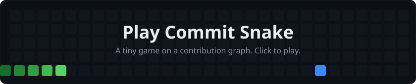

I build fast, scalable web and mobile apps with clean architecture, 
considered UX, and data you can actually act on.

 

  

 

## Play a quick game

Stay a minute. Beat my high score.

  

 

## About

I'm a full-stack developer who likes the whole path from database to pixel. I care about APIs that stay fast under load, interfaces that feel obvious to use, and codebases a new teammate can read on day one.

- Shipping cross-platform mobile apps with **Flutter** and web apps with **React** and **Next.js**
- Designing backends in **Django**, **FastAPI**, and **Node.js** on **PostgreSQL**
- Building dashboards that turn raw data into decisions
- Currently deepening my knowledge of **system design** and **cloud architecture**

## Tech stack

| Area | What I focus on |
|---|---|
| Performance | Fast APIs, efficient queries, smooth apps |
| Architecture | Clean, modular, scalable systems |
| UX/UI | Clear, accessible, polished interfaces |
| Data | Interactive dashboards and visualization |

## Featured projects

 

 

 

## GitHub activity

 

  

<picture>
  <source media="(prefers-color-scheme: dark)" srcset="https://raw.githubusercontent.com/hussainahmad2/hussainahmad2/output/github-snake-dark.svg"/>
  <source media="(prefers-color-scheme: light)" srcset="https://raw.githubusercontent.com/hussainahmad2/hussainahmad2/output/github-snake.svg"/>
  
</picture>

## Let's work together

I'm open to full-stack roles, freelance projects, and collaborations on products that matter. The fastest way to reach me is [email](mailto:hussainahmadbilal@gmail.com) or [LinkedIn](https://www.linkedin.com/in/hussainahmadbilal/).

 

